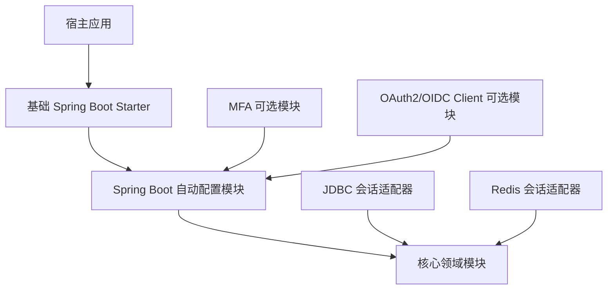

# Rose Security 从零设计

## 目标

Rose Security 是供 Spring Boot 应用组合使用的认证与会话基础设施。它把 Spring Security 的认证扩展点、JWT 生命周期和可撤销会话组合成可复用能力，同时让宿主继续控制用户数据、业务授权和整条安全过滤链。

核心承诺：宿主提供认证管理器、签名配置和会话存储，并显式将 Rose configurer 加入自己的 `SecurityFilterChain`，即可获得一致的登录、令牌刷新和会话撤销流程。启用 Rose 时，缺少必需配置或 Bean 会导致应用启动失败并指出缺项。自动配置无法可靠判断宿主是否实际将 configurer 应用到安全链；挂载是宿主的必需步骤，由 sample 和集成文档明确说明。

Rose 不做通用 IAM，不创建宿主的安全链，不替宿主决定某个用户可以访问哪些业务资源。

## 设计原则

- **以 Spring Security 为认证框架。** 接入 `AuthenticationManager` 与标准认证结果，不复制用户名密码校验机制。
- **宿主拥有安全策略。** 授权匹配器、CSRF、CORS、错误响应和请求链顺序由宿主配置。
- **小而深的模块。** 每个模块对外提供少量稳定接口，隐藏令牌校验、轮换、并发消费等复杂性。只有确有两种实现时才抽出适配 seam。
- **可选能力不污染核心。** MFA、OAuth2/OIDC、API Key 等独立组合，不作为基础 starter 的传递依赖。
- **状态转换显式且可验证。** 明确未认证、认证完成、刷新、撤销和失败状态；令牌签发与持久化状态保持一致。
- **安全缺省不静默降级。** 缺少必须的签名配置、会话存储或关键属性时给出明确错误；存储故障 fail closed 并返回服务错误。

## ThingsBoard 参考与取舍

设计参考来自本机 ThingsBoard `master` checkout（检查时提交 `7a53801216`），仅用于说明认证 Provider 组合和 MFA 状态转换的组织方式，不作为 Rose 的实现依赖或行为规范。该 checkout 中安全配置显式注册密码、JWT、API Key 和 Refresh Token providers；不同请求凭据由专用过滤器处理；密码登录成功后再根据 MFA 状态决定签发完整 token pair、预验证 token，还是 MFA 配置 token。涉及该参考的结论应以对应源码版本为准。

Rose 借鉴它的**机制组织方式**，不复制其平台模型：

- 把不同凭据验证实现放在独立 `AuthenticationProvider` 或可选模块中，通过 Spring Security `AuthenticationManager` 组合。
- 让认证入口各自解析协议数据，再交给 provider；认证成功/失败响应统一由 handler 负责。
- 把认证过程看成状态转换。若后续加入 MFA，主凭据通过只进入受限 challenge 状态；验证完成后才创建正常会话和完整凭据。challenge 凭据必须限制 audience/scope、可用时间和用途，不能刷新成完整 token。
- 将失败计数、发送频率限制和用户锁定纳入 MFA 模块的策略接口或宿主集成契约，而不是仅在 UI 或控制器层处理。
- 保留 Rose 面向宿主的安全链所有权。ThingsBoard 是完整平台，可以定义自己的多条 `SecurityFilterChain`、租户策略和 endpoint matcher；Rose 只提供 configurer 与过滤器，由宿主决定链的范围和授权。

ThingsBoard 的 `SecurityUser` 同时携带平台权限，API Key 可据自身权限对用户权限做上限约束。这依赖 ThingsBoard 的租户和权限模型，Rose 不应把它抽象成通用核心接口。Rose 的认证结果只承载认证身份与认证上下文；授权数据和决策留给宿主的 Spring Security 配置及业务权限系统。

这些观察来自 `application/.../ThingsboardSecurityConfiguration.java`、`RestAuthenticationProvider.java`、`RestAwareAuthenticationSuccessHandler.java`、`DefaultTwoFactorAuthService.java` 和 `ApiKeyAuthenticationProvider.java`。此参考用于设计取舍，不构成 Rose 对这些能力的当前实现声明。

## 职责划分

| 主题 | Rose Security | 宿主应用 |
|---|---|---|
| 身份认证 | 提供登录请求解析、过滤器和认证结果处理；提供可选的 `SecurityUser` 身份快照 | 提供 `AuthenticationManager`/`AuthenticationProvider`、用户查询、凭据验证、稳定 subject 映射与账户状态规则 |
| 用户与凭据 | 不定义持久化用户模型 | 注册、用户资料、密码散列策略、改密、找回和账户生命周期 |
| 令牌 | access JWT、默认启用且可关闭的 refresh token、轮换、验证与 JWKS 集成；约束 TTL 与 claims | 选择密钥托管方式、有效期范围、密钥轮换和浏览器/客户端传输方式 |
| 会话 | 会话接口、会话标识、撤销、并发策略 | 选择存储并运行迁移；决定会话管理接口是否对外暴露 |
| 请求授权 | 提供可组合认证过滤器 | 创建 `SecurityFilterChain`、授权业务端点、CSRF/CORS 和代理信任 |
| 业务权限 | 不定义角色、租户和资源授权模型 | 负责权限计算、资源范围与多租户隔离 |
| 扩展认证 | 后续通过独立模块加入 | 决定是否启用、账号关联、恢复与强制策略 |

## 目标模块



箭头表示 Maven 编译依赖。宿主按需选择 JDBC 或 Redis 适配器；基础 starter 不依赖任何存储适配器。首版交付两种适配器，但宿主也可提供自定义 `SessionStore`。MFA/OIDC 模块依赖 autoconfigure 中的认证生命周期扩展点，不允许 autoconfigure 反向依赖这些模块。

### 核心领域模块

纯 Java 的领域类型和窄接口，不依赖 Spring Boot、Servlet、JDBC 或 Redis。

- 会话身份和签发结果值类型。
- `SessionStore`：创建和读取会话、原子轮换 refresh 凭据、撤销会话及 subject 的全部活动会话；启用并发会话上限时原子检查并创建。
- 会话与令牌结果值类型；契约明确 subject、session id 和过期时间。
- 活动会话上限由配置指定，首版不提供可编程驱逐策略接口。
- Rose 不提供持久化用户实体。认证后的登录 principal 由宿主定义，Rose 只通过 `SubjectResolver` 读取稳定 subject；角色、租户、资料和授权信息仍由宿主承载。
- 不包含 HTTP 路由、JSON 格式、用户实体、角色或数据库 schema。

`SessionStore` 提供只读 refresh 摘要解析，以取得其绑定的 subject、session 和凭据状态。解析结果分为当前凭据、已消费凭据和无效凭据。若为当前凭据，Rose 据此签发候选 token pair，再调用原子轮换操作；若并发请求已先消费该凭据，轮换操作必须原子识别重放并撤销 session。若只读解析已确认凭据被消费，则调用原子重放处理操作完成确认与撤销。只读解析不改变状态，不能代替最终原子操作。

会话存储需满足以下可观察保证：refresh 凭据只能成功轮换一次；重放识别与撤销所属 session 是同一个原子操作；随机未知、过期或已撤销凭据不会改变状态；已消费凭据的摘要保留到 session 绝对过期，轮换不延长该期限。存储接口应返回明确的领域结果（轮换成功、已确认重放、无效凭据、并发会话数已满），后端不可用或操作结果未知时归一为存储故障，不向上层暴露 JDBC/Redis 异常类型。

登出全部后，其线性化点之前创建的会话均不可继续使用，并发登录的结果按创建操作与登出操作的先后决定。请求通过会话检查后已开始执行的业务操作不会被登出中断。适配器可自行选择数据布局和原子操作方式，但必须通过同一行为契约测试。

首版会话并发策略只提供可选的每 subject 最大活动会话数；达到上限时拒绝新会话，不自动踢除旧会话。活动 session 指未撤销且绝对期限晚于当前时间的 session；已过期但尚未清理的记录不占名额。上限检查与创建必须由 `SessionStore` 原子完成；并发登录时只有在上限内的创建可成功，其余返回 `session_limit_reached`。未配置上限表示不限制。首版不支持多种驱逐策略。

### Spring Boot 自动配置模块

Spring Boot 与 Spring Security 的集成实现。

- `@ConfigurationProperties` 与输入校验。
- Access token 使用 Spring `JwtEncoder`/`JwtDecoder` 和 Resource Server 验证。首版必需 claims 为 `sub`（稳定且不可复用的 subject 标识）、`sid`（唯一会话标识）、`iss`、`aud`、`iat`、`exp`；签发端从配置生成 `iss`、`aud` 和有效期。宿主提供签发私钥或 `JwtEncoder`，并提供验证公钥或 `JwtDecoder`；宿主 decoder 负责验证签名并决定签名信任来源，Rose 在认证后强制检查必需 claims、issuer、audience、时间边界及 session 状态，宿主自定义组件不得绕过这些检查。JWT `sub` 必须与 `sid` 对应 session 中保存的 subject 完全一致。Audience 可配置一个或多个值，签发 token 使用该集合，验证时至少匹配一个配置值。Clock skew 默认零，可由宿主统一配置；无论容差如何，令牌都不得在 session 绝对过期后继续使用。Access token 的有效期取配置 TTL 与 session 剩余期限的较小值，TTL 还须通过 Rose 的上限校验；具体默认值和上限在实现前通过威胁模型与 sample 场景确定。首版不提供任意自定义 claims 注入点。

  JWKS 仅作为 Resource Server 可配置的公钥来源（静态公钥或远端 JWKS URI），Rose 不提供 JWKS 发布端点；密钥发布、轮换、`kid` 选择、旧公钥保留窗口和私钥保护由宿主负责。首版 refresh token 采用不透明高熵随机值，仅以不可逆摘要形式存储；它不接受为 Bearer access token。
- 登录、刷新、登出过滤器及成功/失败处理器。
- 宿主提供 `SubjectResolver`，将认证成功的 Spring Security principal 映射为稳定且不可复用的 subject；映射失败则拒绝创建会话。不得默认使用可能被修改或复用的用户名、邮箱作为 subject。
- 提供可选、不可变的 `SecurityUser` 身份快照，字段为稳定 `subject`、`sessionId` 和从 JWT `iat` 得到的 `issuedAt`。它只代表 access token 的身份与 session，不是用户实体，不包含密码、资料、角色或租户，也不替换宿主在登录时使用的 principal。
- 提供可选的 JWT principal converter，将验证后的 JWT 转换为 `SecurityUser`；默认保留 Spring Resource Server 的 `Jwt` principal。使用转换器时，`Authentication` 的 authorities 仍由宿主的 authority converter 决定，`SecurityUser` 本身不承载授权数据。
- 登录成功后先生成候选 `sid` 并签发完整候选凭据，再原子创建会话并保存 refresh 摘要；只有存储成功后才写响应。签名失败发生在持久化前，不留下会话；存储失败时不返回凭据。
- 刷新时先签发候选 access token 和 refresh token，再由一次原子存储操作消费旧摘要并保存新摘要。旧凭据已消费的重放会在同一原子操作中撤销所属 session；未知、过期或已撤销凭据不改变状态。存储异常或结果未知时返回 503、不自动重试；客户端重试旧 token 可能被识别为重放并导致 session 撤销。
- 登录或刷新只有在会话状态持久化成功后才开始写响应。应用能观察到响应写入异常时，尽力撤销本次 session 并记录补偿结果；存储与网络响应不能原子提交，因此这是 best effort，无法保证客户端没有收到部分或完整的、随后失效的凭据。补偿失败必须可观测。
- 提供宿主显式应用到其 `HttpSecurity` 的 configurer，不创建默认 `SecurityFilterChain`。宿主配置 Spring Resource Server `.oauth2ResourceServer(...jwt...)` 完成 access Bearer token 认证；Rose 在认证后强制验证 claims 并检查 `sid` 与 subject 对应的 session 状态。每个受保护请求都检查存储，不缓存检查结果。
- 自动配置只创建条件满足的 bean，宿主 bean 可覆盖默认实现。

该模块的外部接口以一个 configurer、类型安全配置和必要扩展点为主，不让消费者直接编排内部过滤器。

### 存储适配模块

- JDBC 会话适配器：基于 JDBC 实现 `SessionStore`，提供 schema 资源；迁移由宿主 Flyway/Liquibase 或其他工具执行。
- Redis 会话适配器：基于 Redis 实现 `SessionStore`，并记录所需原子操作和过期行为。
- 两者都只实现会话 seam，不定义用户表，不静默启动基础设施。

### 便利 starter 与 BOM

- 基础 Spring Boot Starter 只引入通用认证自动配置和 Spring Security 所需依赖，不传递引入 JDBC、Redis、MFA 或 OAuth 客户端。
- 依赖管理模块统一 Rose 模块版本，不替消费者管理无关依赖版本。

MFA、OAuth2/OIDC 和 API Key 不属于第一阶段；若未来纳入，单独定义其接口与威胁模型。自动开户、权限范围和账户策略仍由宿主负责。

## 核心接口与状态模型

外部登录入口解析 JSON 凭据并交给宿主的 Spring Security `AuthenticationManager`。首版由宿主提供认证管理器和用户凭据验证；Rose 不读取用户表或自行散列密码。

```text
密码登录
  解析 username/password → 宿主 AuthenticationManager 认证
  → 解析稳定 subject → 生成 sid 并签发候选 token pair
  → 原子按并发策略创建会话 → 写响应

refresh
  只读解析 refresh_token → 预先签发候选 token pair
  → 原子消费旧摘要并保存新摘要（并发重放则原子撤销 session）
  → 成功返回新凭据；无效凭据返回 401；存储故障/结果未知返回 503

重放
  已消费的 refresh 凭据再次提交时返回 401 `refresh_token_replayed`，并撤销该凭据所属的 session

登出（需签名、claims、期限有效且 subject 与 session 绑定一致的 Bearer access token；允许对已撤销 session 幂等重试）
  单会话：仅撤销与当前 sub 匹配的 sid；全部登出：使当前 sub 的活动会话失效
```

每个通过 Bearer JWT 认证的受保护请求都检查 session 状态和 subject 绑定；存储不可用时 fail closed 并返回 503。首版不缓存检查结果，保证撤销立即影响后续请求。请求通过检查后已经开始执行的业务操作不会被登出中断。无效、过期或已撤销 session 统一返回 401；不区分 session 不存在、过期或撤销。Refresh 重放撤销 session；响应结果未知时客户端重试可能触发重放，因此需要重新登录。

`SessionStore` 是会话状态的 seam；Spring `JwtEncoder` 是签名的 seam；宿主的 `AuthenticationManager` 是身份凭据验证的 seam。测试应从这些接口观察成功、拒绝、重放、并发与故障结果。

第一版不承诺统一用户 schema、授权表达式、认证事件总线或通用风险评分。若后续存在多个真实消费者需求，再设计相应接口。

## 自动配置契约

- 总开关 `rose.security.enabled` 默认开启；显式关闭时不注册 Rose 组件，也不要求 Rose 的 `AuthenticationManager`、JWT 配置或 `SessionStore` 依赖。
- 基础自动配置不因缺少可选 JDBC/Redis/OAuth/MFA 依赖而失败。
- 全局启用时，登录、单会话登出、登出全部和请求撤销检查作为一组必需能力，不能单独关闭；refresh 默认启用，可通过 `rose.security.refresh.enabled=false` 关闭。无论 refresh 是否启用，登录和撤销检查都需要 `SessionStore`。缺少唯一有效的宿主 `AuthenticationManager`、JWT 签发配置、Resource Server JWT 验证配置或 `SessionStore` 时，应用启动失败并指出缺项。
- `AuthenticationManager` 由 Spring Security 的 `AuthenticationConfiguration` 提供，使用其 `getAuthenticationManager()` 取得宿主最终配置的管理器；不要求宿主重复声明同一管理器为 Bean。若宿主显式提供 `AuthenticationManager` Bean，则优先注入该 Bean；若无法取得管理器或存在多个无法消歧的候选，启动失败并提示宿主显式指定。JWT 密钥/encoder/decoder、`SessionStore` 和策略 Bean 按上述功能条件使用；不提供自定义 `TokenIssuer` 扩展点。
- 首版密码登录直接调用注入的宿主 `AuthenticationManager`；缺少管理器时启动失败，不创建空 manager 或静默接受认证。
- 首版要求宿主提供 `SubjectResolver`；缺少解析器时启动失败。该解析器只负责将已认证 principal 映射到稳定 subject，不承接用户查询或业务授权。
- 受保护 API 使用 Spring Resource Server Bearer JWT 认证；全局启用时，Rose 要求相应的资源服务器认证配置和 `SessionStore`。
- Rose 提供 configurer，但只有宿主显式 `.with(...)` 后才会将过滤器加入该安全链。自动配置不能可靠检测 configurer 是否已应用；宿主必须挂载 configurer，并在自己的授权规则中允许登录和启用时的 refresh 端点、保护登出与受保护 API。登出端点仍验证签名、claims、期限及 `sub`/`sid` 绑定，但允许已撤销 session 的 token 重复调用以维持幂等；此例外仅适用于登出，不适用于其他受保护 API。Rose 不创建或修改宿主的授权规则、CSRF、CORS 或过滤链顺序。
- 启用 refresh 时，端点只接受 JSON body 中的 `refresh_token`；不接受 Bearer access token。登录/refresh 请求使用 JSON body，宿主负责 HTTPS、登录限流与账户保护、CSRF/CORS 和代理信任。Rose 不设置 Cookie。
- 必需属性在启动阶段验证；空密钥、无效 TTL、相互冲突的 endpoint 和不安全的刷新配置不得静默通过。Audience 至少配置一个允许值；clock skew 默认零；TTL 具体默认值与上限在实现前通过威胁模型和 sample 场景确定。
- 每个条件配置至少有正向、关闭条件、缺依赖、宿主覆盖四类上下文测试。

### HTTP API 契约

以下路径为默认值，可分别配置；Rose 的四个端点配置不得互相冲突。宿主负责避免与其已有路由冲突。

| 方法与路径 | 认证 | 请求 | 成功响应 |
|---|---|---|---|
| `POST /api/auth/login` | 匿名 | `{"username":"...","password":"..."}` | `200`，返回 access token 与启用时的 refresh token |
| `POST /api/auth/refresh` | 匿名 | `{"refresh_token":"..."}` | `200`，返回轮换后的 token pair |
| `POST /api/auth/logout` | claims 有效且 `sub`/`sid` 绑定一致的 Bearer access token | 空 body | `204`，幂等撤销与当前 `sub` 匹配的 `sid` |
| `POST /api/auth/logout-all` | claims 有效且 `sub`/`sid` 绑定一致的 Bearer access token | 空 body | `204`，幂等撤销当前 `sub` 的全部活动 session |

登出端点仅跳过“session 当前仍活动”的检查；仍须验证签名、必需 claims、token 期限，以及 token `sub` 与保留 session 记录的 subject 绑定。session 撤销记录保留到其绝对期限，以支持有效期内的登出重试。其他受保护 API 对已撤销 session 返回 401。

登录与 refresh 成功响应包含 `access_token`、`token_type`（固定为 `Bearer`）和 `expires_in`（access token 剩余有效秒数）；refresh 启用时还包含 `refresh_token`，关闭时省略。响应不暴露 session 内部字段。

错误响应使用 JSON，至少包含机器可读的 `error` 和通用 `message` 字段。宿主可自定义 message 和附加字段，但必须保留 HTTP 状态码与 `error`。错误码如下：

| 状态码 | `error` | 场景 |
|---|---|---|
| `400` | `invalid_request` | JSON 无法解析、字段缺失或类型错误 |
| `401` | `invalid_credentials` | 登录认证失败，包括锁定、禁用或过期凭据 |
| `401` | `invalid_access_token` | Bearer JWT 签名无效、必需 claims 缺失或 issuer/audience/时间校验失败 |
| `401` | `invalid_refresh_token` | refresh token 未知、过期、已撤销，或重放摘要已清理 |
| `401` | `refresh_token_replayed` | 确认的 refresh 重放；所属 session 已在同一原子操作中撤销 |
| `401` | `invalid_session` | access token 的 session 无效、过期、已撤销或 subject 不匹配 |
| `409` | `session_limit_reached` | 新登录会超过 subject 的活动 session 上限 |
| `503` | `storage_unavailable` | 存储不可用或操作结果未知，包括撤销检查失败 |
| `500` | `token_issuance_failed` | JWT 签发器发生未预期的运行时错误 |

登录与 refresh 的认证入口不接受 Bearer 身份凭据；refresh 请求若携带 `Authorization: Bearer`，返回 `400 invalid_request`。受保护 API 上 session 无效时返回 401；session 存储故障时返回 503。业务授权失败及其 403 响应由宿主决定。

## 第一阶段交付范围

1. 宿主 `AuthenticationManager` 驱动的 JSON 登录接入；启动时必须能注入唯一有效的宿主管理器。
2. Access JWT 签发/验证和 JWKS；支持宿主管理密钥。
3. 默认启用 refresh token，并通过 `rose.security.refresh.enabled=false` 提供关闭能力；启用时先签发候选凭据，再原子单次轮换。已消费凭据重放（包括并发竞争失败或响应丢失后的重试）会拒绝请求并撤销所属 session。
4. 登出单会话、登出全部会话及请求时撤销检查；登录、登出和撤销检查作为一组必需能力，不提供独立开关。缺少 Resource Server JWT 配置或存储时启动失败。
5. `SessionStore`、并发会话策略，以及独立发布的 JDBC/Redis 适配器。基础 starter 不传递引入适配器；宿主显式添加其中一个适配器或提供自定义 `SessionStore`。首版交付包含两个适配器模块，但使用者按需选择。
6. 最小 sample：宿主 `AuthenticationManager` 与 `SubjectResolver`、宿主安全链、端点授权规则、受保护端点、登录/刷新/撤销演示。
7. 完整属性说明、API 契约和失败语义文档。

第一阶段明确不包括注册、密码管理、用户/角色/租户模型、业务授权、MFA、OAuth2/OIDC 登录和 API Key。

## 验收标准

- 全新宿主可按 sample 完成登录、访问受保护端点、刷新令牌和撤销会话。
- 宿主能提供认证管理器、令牌签名配置、错误响应和授权链；Rose 不接管安全链。
- 所有端点的成功、认证失败、无效请求、session 上限和存储故障均符合 HTTP API 契约中的状态码与错误码；宿主自定义错误正文仍保留机器错误码。
- refresh 并发轮换最多成功一次；确认重放与 session 撤销原子完成；响应丢失重试、结果未知、响应写入补偿和已消费摘要过期边界均有行为覆盖。
- 登录、签发、存储和响应失败路径有测试，确保没有未经持久化的凭据被正常返回；补偿失败有可观测诊断。
- JWT 必需 claims、audience、时间边界、subject/session 绑定和撤销检查均有验证；可选 `SecurityUser` converter 保留宿主 authorities，登出重复调用幂等，登出全部与并发登录按线性化结果验证。
- JDBC/Redis 适配器对同一 `SessionStore` 契约通过一致的行为测试。
- 仅添加基础 starter 时不加载可选适配器或可选认证模块。
- README、配置元数据、API 契约、sample 和代码实现一致；sample 明确展示挂载 configurer、允许登录/refresh、保护登出/业务 API。
- 构建、单元测试、集成测试、格式检查分别报告，不用单一 `test` 结果代替生产安全声明。

## 从现有仓库迁移

现有代码只作为行为参考和可复用材料，不约束目标模块结构。开始迁移前先冻结当前实现的外部行为和需要保留的兼容契约；随后按 `core → autoconfigure → 存储适配 → starter → sample` 顺序重建。旧实现仅在新模块有等价接口、行为测试通过后删除，避免同时维护两套长期入口。
