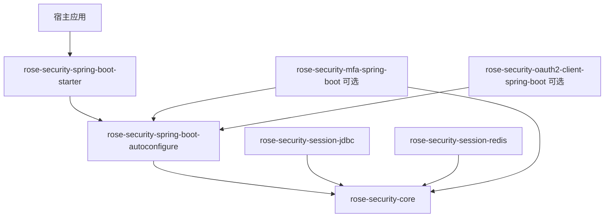

# Rose Security 从零设计

## 目标

Rose Security 是供 Spring Boot 应用组合使用的认证与会话基础设施。它把 Spring Security 的认证扩展点、JWT 生命周期和可撤销会话组合成可复用能力，同时让宿主继续控制用户数据、业务授权和整条安全过滤链。

核心承诺：宿主提供认证身份来源与密钥/存储配置，将 Rose configurer 加入自己的 `SecurityFilterChain`，即可获得一致的登录、令牌刷新和会话撤销流程。

Rose 不做通用 IAM，不创建宿主的安全链，不替宿主决定某个用户可以访问哪些业务资源。

## 设计原则

- **以 Spring Security 为认证框架。** 接入 `AuthenticationManager` 与标准认证结果，不复制用户名密码校验机制。
- **宿主拥有安全策略。** 授权匹配器、CSRF、CORS、错误响应和请求链顺序由宿主配置。
- **小而深的模块。** 每个模块对外提供少量稳定接口，隐藏令牌校验、轮换、并发消费等复杂性。只有确有两种实现时才抽出适配 seam。
- **可选能力不污染核心。** MFA、OAuth2/OIDC、API Key 等独立组合，不作为基础 starter 的传递依赖。
- **状态转换显式且可验证。** 明确未认证、认证完成、刷新、撤销和失败状态；令牌签发与持久化状态保持一致。
- **安全缺省不静默降级。** 缺少必须的密钥、会话存储或关键属性时给出明确错误；存储故障按配置定义失败行为。

## ThingsBoard 参考与取舍

本机 ThingsBoard `master` checkout（检查时提交 `7a53801216`）展示了一个成熟平台如何组合 Spring Security：安全配置显式注册密码、JWT、API Key 和 Refresh Token providers；不同请求凭据由专用过滤器处理；密码登录成功后再根据 MFA 状态决定签发完整 token pair、预验证 token，还是 MFA 配置 token。

Rose 借鉴它的**机制组织方式**，不复制其平台模型：

- 把不同凭据验证实现放在独立 `AuthenticationProvider` 或可选模块中，通过 Spring Security `AuthenticationManager` 组合。
- 让认证入口各自解析协议数据，再交给 provider；认证成功/失败响应统一由 handler 负责。
- 把认证过程看成状态转换。若后续加入 MFA，主凭据通过只进入受限 challenge 状态；验证完成后才创建正常会话和完整凭据。challenge 凭据必须限制 audience/scope、可用时间和用途，不能刷新成完整 token。
- 将失败计数、发送频率限制和用户锁定纳入 MFA 模块的策略接口或宿主集成契约，而不是仅在 UI 或控制器层处理。
- 保留 Rose 面向宿主的安全链所有权。ThingsBoard 是完整平台，可以定义自己的多条 `SecurityFilterChain`、租户策略和 endpoint matcher；Rose 只提供 configurer 与过滤器，由宿主决定链的范围和授权。

ThingsBoard 的 `SecurityUser` 同时携带平台权限，API Key 可据自身权限对用户权限做上限约束。这依赖 ThingsBoard 的租户和权限模型，Rose 不应把它抽象成通用核心接口。Rose 的认证结果只承载认证身份与认证上下文；授权数据和决策留给宿主的 Spring Security 配置及业务权限系统。

这些观察来自 `application/.../ThingsboardSecurityConfiguration.java`、`RestAuthenticationProvider.java`、`RestAwareAuthenticationSuccessHandler.java`、`DefaultTwoFactorAuthService.java` 和 `ApiKeyAuthenticationProvider.java`。此参考用于设计取舍，不构成 Rose 对这些能力的当前实现声明。

## 职责划分

| 主题 | Rose Security | 宿主应用 |
|---|---|---|
| 身份认证 | 组合 Spring Security 认证管理器，提供登录过滤器与认证成功/失败处理 | 提供 `AuthenticationManager`/`AuthenticationProvider`、用户查询、凭据验证与账户状态规则 |
| 用户与凭据 | 不定义持久化用户模型 | 注册、用户资料、密码散列策略、改密、找回和账户生命周期 |
| 令牌 | access JWT、可选 refresh token、轮换、验证与 JWKS 集成 | 选择密钥托管方式、令牌 TTL 和浏览器/客户端传输方式 |
| 会话 | 会话接口、会话标识、撤销、并发策略 | 选择存储并运行迁移；决定会话管理接口是否对外暴露 |
| 请求授权 | 提供可组合认证过滤器 | 创建 `SecurityFilterChain`、授权业务端点、CSRF/CORS 和代理信任 |
| 业务权限 | 不定义角色、租户和资源授权模型 | 负责权限计算、资源范围与多租户隔离 |
| 扩展认证 | 后续通过独立模块加入 | 决定是否启用、账号关联、恢复与强制策略 |

## 目标模块



### `rose-security-core`

纯 Java 的领域类型和窄接口，不依赖 Spring Boot、Servlet、JDBC 或 Redis。

- 会话身份和签发结果值类型。
- `SessionStore`：创建会话、按标识读取、原子轮换 refresh 状态、撤销单会话/用户会话。
- `TokenIssuer`：为已认证身份创建 access/refresh 凭据；接口契约明确 subject、session id 和过期时间。
- 可替换的 subject 解析策略与会话并发策略。
- 不包含 HTTP 路由、JSON 格式、用户实体、角色或数据库 schema。

接口需要保证关键状态变更具有原子语义。存储适配器不得把“读取后再写回”伪装成原子消费。

### `rose-security-spring-boot-autoconfigure`

Spring Boot 与 Spring Security 的集成实现。

- `@ConfigurationProperties` 与输入校验。
- JWT 编码/解码和 JWKS 集成，允许宿主提供密钥或编码器/解码器。
- 登录、刷新、登出过滤器及成功/失败处理器。
- 登录成功后创建服务端会话，之后签发令牌；刷新时原子轮换 refresh 凭据。
- 提供宿主显式应用到其 `HttpSecurity` 的 configurer，不创建默认 `SecurityFilterChain`。
- 自动配置只创建条件满足的 bean，宿主 bean 可覆盖默认实现。

该模块的外部接口以一个 configurer、类型安全配置和必要扩展点为主，不让消费者直接编排内部过滤器。

### 存储适配模块

- `rose-security-session-jdbc`：基于 JDBC 实现 `SessionStore`，提供 schema 资源；迁移由宿主 Flyway/Liquibase 或其他工具执行。
- `rose-security-session-redis`：基于 Redis 实现 `SessionStore`，并记录所需原子操作和过期行为。
- 两者都只实现会话 seam，不定义用户表，不静默启动基础设施。

### 便利 starter 与 BOM

- `rose-security-spring-boot-starter` 只引入通用认证自动配置和 Spring Security 所需依赖，不传递引入 JDBC、Redis、MFA 或 OAuth 客户端。
- `rose-security-bom` 统一 Rose 模块版本，不替消费者管理无关依赖版本。

### 后续可选认证模块

- **MFA**：作为一组认证 provider、受限 challenge 状态和因素适配器加入；不得在 challenge 完成前创建完整会话或签发完整业务凭据。平台强制范围、账户管理和恢复流程由宿主控制；通用限流/锁定仅在接口能由宿主策略替换时纳入模块。
- **OAuth2/OIDC Client**：复用 Spring Security OAuth2 Client；账号映射和自动开户由宿主实现。
- **API Key**：认证凭据解析与失效检查可由可选模块提供；权限范围和密钥管理归宿主。

这些是候选模块，不属于第一阶段实现。每个模块都需单独完成威胁模型、接口契约和验证计划后再开始开发。

## 核心接口与状态模型

外部登录入口解析 JSON 凭据并交给 Spring Security `AuthenticationManager`。首版由宿主提供认证管理器和用户凭据验证；Rose 不读取用户表或自行散列密码。后续可选认证方式各自增加 token/provider 与入口解析器，不扩充单个过滤器中的模式分支。

```text
未认证请求
    └─ AuthenticationManager 认证失败 → 认证失败响应
    └─ AuthenticationManager 认证成功 → 创建会话 → 签发 access/refresh

有效 refresh token
    └─ 原子轮换成功 → 新 token pair
    └─ 已撤销/过期/重放 → 拒绝并按策略撤销会话或 token family

登出
    └─ 撤销指定会话；登出全部则撤销 subject 的所有活动会话
```

`SessionStore` 是会话状态的 seam；`TokenIssuer` 是令牌签发的 seam；宿主的 `AuthenticationManager` 是身份凭据验证的 seam。测试应从这些接口观察成功、拒绝、重放和并发结果。

第一版不承诺统一用户 schema、授权表达式、认证事件总线或通用风险评分。若后续存在多个真实消费者需求，再设计相应接口。

## 自动配置契约

- 总开关 `rose.security.enabled` 默认开启；显式关闭时不注册 Rose 组件。
- 基础自动配置不因缺少可选 JDBC/Redis/OAuth/MFA 依赖而失败。
- host-provided `AuthenticationManager`、`JwtEncoder`、`JwtDecoder`、`TokenIssuer`、`SessionStore` 和策略 bean 优先。
- configurer bean 可以存在，但只有宿主显式 `.with(...)` 后才修改其安全链。
- 必需属性在启动阶段验证；空密钥、无效 TTL、相互冲突的 endpoint 和不安全的刷新配置不得静默通过。
- 每个条件配置至少有正向、关闭条件、缺依赖、宿主覆盖四类上下文测试。

## 第一阶段交付范围

1. 宿主 `AuthenticationManager` 驱动的 JSON 登录接入。
2. Access JWT 签发/验证和 JWKS；支持宿主管理密钥。
3. 可选 refresh token，单次轮换和重放处理。
4. 登出单会话、登出全部会话及请求时撤销检查。
5. `SessionStore`、并发会话策略，以及 JDBC/Redis 适配器。
6. 最小 sample：宿主认证 Bean、宿主安全链、受保护端点、登录/刷新/撤销演示。
7. 完整属性说明、API 契约和失败语义文档。

第一阶段明确不包括注册、密码管理、用户/角色/租户模型、业务授权、MFA、OAuth2/OIDC 登录和 API Key。

## 验收标准

- 全新宿主可按 sample 完成登录、访问受保护端点、刷新令牌和撤销会话。
- 宿主能自定义认证管理器、令牌密钥、错误响应和授权链；Rose 不接管安全链。
- refresh 轮换在并发请求中最多成功一次，重放和存储故障有明确、测试覆盖的结果。
- JDBC/Redis 适配器对同一 `SessionStore` 契约通过一致的行为测试。
- 仅添加基础 starter 时不加载可选适配器或可选认证模块。
- README、配置元数据、API 契约、sample 和代码实现一致。
- 构建、单元测试、集成测试、格式检查分别报告，不用单一 `test` 结果代替生产安全声明。

## 从现有仓库迁移

现有代码只作为行为参考和可复用材料，不约束目标模块结构。开始迁移前先冻结当前实现的外部行为和需要保留的兼容契约；随后按 `core → autoconfigure → 存储适配 → starter → sample` 顺序重建。旧实现仅在新模块有等价接口、行为测试通过后删除，避免同时维护两套长期入口。
